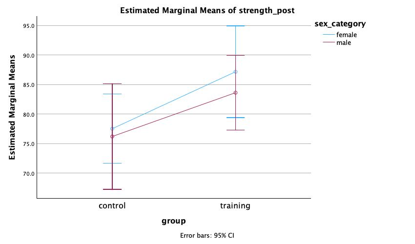
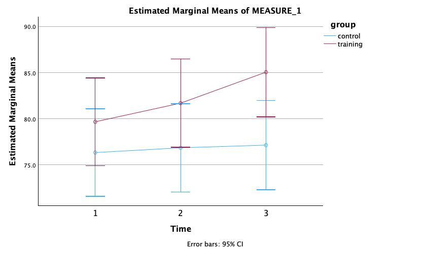

::: {.callout-note icon=false}
## Learning objectives

By the end of this tutorial, you will be able to:

* Run a two-way between-subjects ANOVA (2 × 2) using SPSS *General Linear Model → Univariate*.
* Run a mixed factorial ANOVA (between-subjects × within-subjects) using SPSS *General Linear Model → Repeated Measures*.
* Interpret the SPSS interaction test and determine whether to proceed to simple effects analysis.
* Produce and interpret an SPSS interaction profile plot.
* Conduct simple effects analysis for a significant interaction.
* Calculate partial eta-squared and partial omega-squared from SPSS output.
* Write a complete APA-style results paragraph for a factorial ANOVA.
:::

## Overview

This tutorial covers two complementary factorial designs that appear throughout Chapter 16:

**Part A — Between-subjects factorial ANOVA**: Two factors, each between subjects, testing whether Sex and Group jointly predict post-test strength.

**Part B — Mixed factorial ANOVA**: One between-subjects factor (Group) combined with one within-subjects factor (Time), testing whether strength trajectories differ between groups across a 12-week program.

Both analyses use `core_session_ch16.csv`, a single wide-format file with one row per participant. You should be comfortable with one-way ANOVA (Chapter 14 tutorial) and repeated measures ANOVA (Chapter 15 tutorial) before proceeding.

## Dataset

Download the dataset here: [core_session_ch16.csv](data/core_session_ch16.csv)

- **File**: `core_session_ch16.csv`
- **Variables used (Part A)**: `sex_category`, `group`, `strength_post`
- **Variables used (Part B)**: `group`, `strength_pre`, `strength_mid`, `strength_post`
- **Sample**: *N* = 60 (30 control, 30 training); female (*n* = 33: 21 control, 12 training), male (*n* = 27: 9 control, 18 training)

::: callout-tip
## Save your work before starting

Before running any analysis, save a copy of the dataset under a new name (e.g., `core_session_ch16.sav`). This protects your original file if you need to restructure data or add new variables during the tutorial.
:::

---

## Part A: Two-way between-subjects ANOVA (2 × 2)

### Overview of Part A

This analysis tests the independent and joint effects of Sex (female, male) and Group (control, training) on post-test strength. Because this is a purely between-subjects design — every participant appears in exactly one cell — we use *General Linear Model → Univariate*.

### Step 1: Run the two-way between-subjects ANOVA

1. Click **Analyze → General Linear Model → Univariate**
2. Move `strength_post` to the **Dependent Variable** box
3. Move `group` to **Fixed Factor(s)**
4. Move `sex_category` to **Fixed Factor(s)**
5. Click **EM Means**:
   - Under *Display Means for*, select `group`, `sex_category`, and `group*sex_category` and move them to the 'Display Means for' box
   - Check **Compare main effects** and set *Confidence interval adjustment* to **Bonferroni**

::: callout-note
## Why not request simple effects here?

Simple effects analysis tests the effect of one factor *at each level of the other* (e.g., "Does Group differ among females only?"). It is only warranted when the interaction is statistically significant. Because the Sex × Group interaction in Part A is not significant (*p* = .762), simple effects are not needed — interpreting the main effects directly is appropriate.

If you ran this design with a significant interaction, you would request simple effects by adding a second EMMEANS call via **Paste** (to open the syntax editor) and appending:

```
/EMMEANS=TABLES(sex_category*group) COMPARE(group) ADJ(BONFERRONI)
/EMMEANS=TABLES(sex_category*group) COMPARE(sex_category) ADJ(BONFERRONI)
```

For Part B, where the Group × Time interaction *is* significant, simple effects are conducted using the Split File approach described in Step 5.
:::

6. Click **Options**:
   - Check **Descriptive statistics**, **Estimates of effect size**, and **Homogeneity tests**
   - Click **Continue**
6. Click **Plots**:
   - Move `group` to the **Horizontal Axis** box
   - Move `sex_category` to the **Separate Lines** box
   - Click **Add**, then **Continue**
7. Click **OK**

### Step 2: Interpret Part A output

**Levene's Test of Equality of Error Variances**

SPSS reports Levene's test before the main ANOVA table. A non-significant result (*p* > .05) confirms that the assumption of equal variances across cells is satisfied.

| Levene Statistic | df1 | df2 | p |
|---|---|---|---|
| 1.39 | 3 | 56 | .256 |

*Interpretation*: The test is not significant (*p* = .256), so the homogeneity assumption is satisfied.

**Tests of Between-Subjects Effects**

| Source | Type III SS | df | MS | F | p | η²_p |
|---|---|---|---|---|---|---|
| Corrected Model | 1,040.68 | 3 | 346.89 | 1.93 | .136 | |
| Intercept | 353,988.85 | 1 | 353,988.85 | 1,965.69 | < .001 | |
| sex_category | 79.37 | 1 | 79.37 | 0.44 | .509 | .008 |
| group | 978.12 | 1 | 978.12 | 5.43 | .023 | .088 |
| sex_category × group | 16.69 | 1 | 16.69 | 0.09 | .762 | .002 |
| Error | 10,084.70 | 56 | 180.08 | | | |
| Total | 405,757.98 | 60 | | | | |

The η²_p values are reported automatically by SPSS in the "Partial Eta Squared" column when you checked *Estimates of effect size* in the Options dialog.

**Key decisions:**

1. **Interaction first**: The Sex × Group interaction is *F*(1, 56) = 0.09, *p* = .762, η²_p = .002 — not significant. The lines in the interaction plot (@fig-factorial-interaction in Chapter 16) are roughly parallel, confirming no interaction.
2. **Main effects**: With a non-significant interaction, interpret main effects directly. Group is significant (*F* = 5.43, *p* = .023, η²_p = .088); Sex is not (*F* = 0.44, *p* = .509).

### Step 3: Obtain partial omega-squared (ω²_p)

SPSS reports η²_p automatically when you check **Estimates of effect size** in the Options dialog, but it does not report ω²_p directly. Two options are available to obtain it without hand calculation:

1. **Statistical Calculators appendix** — The interactive effect size tool in the [Statistical Calculators](appendix-statistical-calculators.qmd#sec-omega-p-calc) appendix accepts the SS and MS values from the SPSS output and returns ω²_p for each effect.
2. **SPSS 31 and later** — Use *Analyze → Power Analysis → General Linear Model* to obtain ω²_p alongside η²_p in the output.

For reference, the formula for a between-subjects effect is:

$$\omega^2_p = \frac{SS_{\text{effect}} - df_{\text{effect}} \times MS_{\text{error}}}{SS_{\text{effect}} + (N - df_{\text{effect}}) \times MS_{\text{error}}}$$

The three values you need ($SS_{\text{effect}}$, $df_{\text{effect}}$, $MS_{\text{error}}$) all appear in the *Tests of Between-Subjects Effects* table above. For the Group effect in our example, this yields **ω²_p = .069** — a small-to-medium effect [@olejnik2003].

### Step 4: Part A interaction plot

{#fig-parta-interaction fig-alt="Profile plot showing estimated marginal means of strength_post for female (light blue) and male (dark red) participants in the control and training groups. Both lines slope upward from control (~76–78 kg) to training (~84–87 kg) and are nearly parallel. Error bars are 95% CI. Female training M ≈ 87.2, male training M ≈ 83.6; control groups overlap near 77 kg."}

*Interpretation*: The profile plot confirms the non-significant Sex × Group interaction (*p* = .762). Both lines slope upward from the control to the training group — reflecting the significant main effect of Group (*F* = 5.43, *p* = .023) — and the two lines are nearly parallel, indicating that the training benefit did not differ meaningfully between female and male participants. Female participants in the training group showed slightly higher post-test strength (*M* = 87.18 kg) than their male counterparts (*M* = 83.64 kg), and a similar pattern holds in the control group (female: *M* = 77.54 kg; male: *M* = 76.22 kg), but neither difference reached significance (*p* = .509 for the Sex main effect). The overlapping 95% CI error bars within each group further support the conclusion that sex did not moderate the effect of training.

---

## Part B: Mixed factorial ANOVA (Group × Time)

### Overview of Part B

This analysis tests whether strength trajectories differ between the training and control groups across pre, mid, and post time points. Group is the between-subjects factor; Time is the within-subjects (repeated measures) factor. We use *General Linear Model → Repeated Measures* — the same module used for one-way repeated measures ANOVA in Chapter 15, extended to include Group as a between-subjects factor.

**First**: Open [`core_session_ch16.csv`](data/core_session_ch16.csv) in SPSS (File → Open → Data → CSV Data).

### Step 1: Open the wide-format dataset

For Part B, open [`core_session_ch16.csv`](data/core_session_ch16.csv) in SPSS (File → Open → Data → CSV Data). This dataset contains one row per participant with columns for `group`, `strength_pre`, `strength_mid`, and `strength_post` — no restructuring is needed.

### Step 2: Run the mixed ANOVA

1. Click **Analyze → General Linear Model → Repeated Measures**
2. In the *Within-Subject Factor Name* box, type `Time`
3. Set *Number of Levels* to `3`
4. Click **Add** — "Time(3)" appears in the list
5. Click **Define**
6. Move `strength_pre`, `strength_mid`, and `strength_post` into the **Within-Subjects Variables** boxes (slots 1, 2, 3 respectively — ensure pre goes in slot 1, mid in slot 2, post in slot 3)
7. Move `group` into the **Between-Subjects Factor(s)** box
8. Click **EM MEANS**:
   - Under *Display Means for*, select `group`, `Time`, and `group*Time` and move them to the 'Display Means for' box
   - Check **Compare main effects** → set to **Bonferroni**
   - Click **Continue**
Click on **Options**:
   - Check **Descriptive statistics**, **Estimates of effect size**, and **Homogeneity tests**
   - Click **Continue**
9. Click **Plots**:
   - Move `Time` to the **Horizontal Axis** box
   - Move `group` to the **Separate Lines** box
   - Under Chart Type, select **Line**
   - Under Error Bars, check include error bars and set confidence interval to 95%
   - Click **Continue**
10. Click **OK**

### Step 3: Interpret Part B output

**Levene's Test of Equality of Error Variances**

| Dependent Variable | F | df1 | df2 | p |
|---|---|---|---|---|
| strength_pre | 0.21 | 1 | 58 | .647 |
| strength_mid | 0.19 | 1 | 58 | .667 |
| strength_post | 0.15 | 1 | 58 | .700 |

*Interpretation*: Levene's test is non-significant at all three time points (*p* > .05), indicating that the homogeneity of variance assumption **is met** for the between-subjects factor (Group).

**Mauchly's Test of Sphericity**

| Within-Subjects Effect | Mauchly's W | df | p | Greenhouse-Geisser ε | Huynh-Feldt ε |
|---|---|---|---|---|---|
| Time | .746 | 2 | < .001 | .797 | .830 |

*Interpretation*: Mauchly's test is significant (*p* < .001), indicating that the sphericity assumption **is violated**. The Greenhouse-Geisser epsilon (ε = .797) indicates a moderate violation; use the **Greenhouse-Geisser** row in the next table.

**Tests of Within-Subjects Effects**

| Source | | SS | df | MS | F | p | η²_p |
|---|---|---|---|---|---|---|---|
| Time | Sphericity Assumed | 290.49 | 2 | 145.24 | 108.55 | < .001 | .652 |
| | Greenhouse-Geisser | 290.49 | 1.595 | 182.16 | 108.55 | < .001 | .652 |
| Time × group | Sphericity Assumed | 163.26 | 2 | 81.63 | 61.01 | < .001 | .513 |
| | Greenhouse-Geisser | 163.26 | 1.595 | 102.37 | 61.01 | < .001 | .513 |
| Error(Time) | Sphericity Assumed | 155.22 | 116 | 1.34 | | | |
| | Greenhouse-Geisser | 155.22 | 92.49 | 1.68 | | | |

Because Mauchly's test was significant, use the **Greenhouse-Geisser** row (the second row for each effect).

**Tests of Between-Subjects Effects**

| Source | SS | df | MS | F | p | η²_p |
|---|---|---|---|---|---|---|
| Intercept | 1,136,484.60 | 1 | 1,136,484.60 | 2,213.982 | < .001 | |
| group | 1,294.44 | 1 | 1,294.44 | 2.52 | .118 | .042 |
| Error | 29,772.65 | 58 | 513.32 | | | |

**Key decisions:**

1. **Interaction first**: Time × Group is *F*(1.60, 92.5) = 61.01, *p* < .001, η²_p = .513 — highly significant. Proceed to simple effects analysis before interpreting main effects.
2. **Main effect of Time**: *F*(1.60, 92.5) = 108.55, *p* < .001, η²_p = .652 — significant, but interpret in the context of the interaction.
3. **Main effect of Group**: *F*(1, 58) = 2.52, *p* = .118, η²_p = .042 — not significant. This reflects the fact that groups start similarly and only diverge over time.

### Interaction plot

{#fig-partb-interaction fig-alt="Line graph showing estimated marginal means across three time points for control (blue) and training (dark red) groups. The training group rises steeply from ~79.7 to ~85.1 kg, while the control group remains nearly flat (~76.3 to ~77.1 kg). Error bars (95% CI) are shown at each time point."}

*Interpretation*: The profile plot illustrates the significant Group × Time interaction (*p* < .001). The training group (dark red) shows a steep, progressive increase in strength across all three time points (pre: *M* = 79.7 kg → mid: *M* = 81.7 kg → post: *M* = 85.1 kg), while the control group (blue) remains essentially flat (pre: *M* = 76.3 kg → mid: *M* = 76.9 kg → post: *M* = 77.1 kg). The widening gap between the two lines across time — i.e., the non-parallel trajectories — is the visual signature of a significant interaction. The 95% CI error bars do not overlap at Time 3 (post), reinforcing the statistical significance of the group difference at that time point.

### Step 4: Conduct simple effects analysis

To decompose the significant Group × Time interaction, split the file by Group and run a one-way repeated measures ANOVA on Time separately within each group.

**Split the file by Group:**

1. Click **Data → Split File**
2. Select **Organize output by groups**
3. Move `group` to the **Groups Based on** box
4. Click **OK**

**Run repeated measures ANOVA (same steps as Chapter 15):**

1. Click **Analyze → General Linear Model → Repeated Measures**
2. Define `Time` with 3 levels; define the three time-point variables as before
3. Click **EM Means**: move `Time` to the *Display Means for* box, check **Compare main effects**, and set the adjustment to **Bonferroni**; click **Continue**
4. Click **Options**: check *Descriptive statistics* and *Estimates of effect size*; click **Continue**
5. Click **OK**

SPSS will produce separate output for each group. You will observe:

- **Control group**: Time is statistically significant but practically negligible — *F*(2, 58) = 6.56, *p* = .003, η²_p = .185, yet strength changes by less than 1 kg across the entire program (pre: *M* = 76.34 kg, mid: *M* = 76.85 kg, post: *M* = 77.14 kg). Bonferroni pairwise tests show that only the pre-to-post contrast reaches significance (*p* = .002, Hedges' *g* = .06 — negligible). The within-person error variance is so small that even tiny changes reach *p* < .05.
- **Training group**: Mauchly's test indicated sphericity was violated (*W* = .623, ε = .726), so Greenhouse-Geisser-corrected df are reported. Time F is large and highly significant — strength increases progressively (*F*(1.45, 42.1) = 115.99, *p* < .001, η²_p = .800; all pairwise Bonferroni contrasts *p* < .001).

**Reset the file split after analysis:**

1. Click **Data → Split File**
2. Select **Analyze all cases, do not create groups**
3. Click **OK**

### Step 5: Obtain partial omega-squared for Part B

As with Part A, use either the **[Statistical Calculators](appendix-statistical-calculators.qmd#sec-omega-p-calc)** appendix tool or **SPSS 31+** (*Analyze → Power Analysis → General Linear Model*) to obtain ω²_p for each effect — no hand calculation required.

The key distinction in a mixed ANOVA is that **within-subjects effects** (Time and the interaction) use the within-subjects error term ($MS_{\text{error(W)}}$ from the *Error(Time)* row), while the **between-subjects effect** (Group) uses the between-subjects error ($MS_{\text{Subjects/Group}}$ from the *Tests of Between-Subjects Effects* table). The calculator tool or SPSS handles this automatically once you supply the correct SS, df, and MS values from the two output tables.

For reference, the formulas are:

$$\omega^2_p(\text{within-subjects effect}) = \frac{SS_{\text{effect}} - df_{\text{effect}} \times MS_{\text{error(W)}}}{SS_{\text{effect}} + (N \cdot p - df_{\text{effect}}) \times MS_{\text{error(W)}}}$$

$$\omega^2_p(\text{Group}) = \frac{SS_{\text{Group}} - df_{\text{Group}} \times MS_{\text{Subjects/Group}}}{SS_{\text{Group}} + (N - df_{\text{Group}}) \times MS_{\text{Subjects/Group}}}$$

where $p$ is the number of within-subjects levels (3 time points here) and $N$ is total participants. For our example, the resulting values are: **ω²_p(Time) = .54, ω²_p(Group × Time) = .40, ω²_p(Group) = .025**.

---

## Part C: Interaction plot in SPSS

SPSS generates a basic profile plot when you specify it in the *Plots* dialog. For a more publication-ready error bar chart using Legacy Dialogs, the dataset must first be restructured to long format (Data → Restructure → Restructure selected variables into cases), creating a single `strength_kg` column and a `time` index variable. Then:

1. Click **Graphs → Legacy Dialogs → Error Bars**
2. Select **Summaries for groups of cases** → **Define**
3. Move `strength_kg` to the **Variable** box
4. Move `time` to the **Category Axis** box
5. Move `group` to the **Define Clusters by** box
6. Set *Bars Represent* to **Standard error of mean (95%)**
7. Click **OK**

Double-click the chart to open the Chart Editor. Adjust colors, line styles, axis labels, and font sizes to match your publication style. Export via **File → Export** as an EMF or PNG file.

---

## Part D: APA-style write-up examples

### Part A write-up (between-subjects, no interaction)

> A 2 (Sex: female, male) × 2 (Group: control, training) between-subjects ANOVA was conducted with post-test strength (kg) as the dependent variable. Levene's test indicated equality of error variances, *F*(3, 56) = 1.39, *p* = .256. The Sex × Group interaction was not significant, *F*(1, 56) = 0.09, *p* = .762, η²_p = .002, indicating that the effect of training on post-test strength was similar for male and female participants. The main effect of Group was significant, *F*(1, 56) = 5.43, *p* = .023, η²_p = .088, ω²_p = .069, with the training group (*M* = 85.06 kg, *SD* = 12.48) demonstrating greater post-test strength than the control group (*M* = 77.14 kg, *SD* = 13.98). The main effect of Sex was not significant, *F*(1, 56) = 0.44, *p* = .509, η²_p = .008.

### Part B write-up (mixed ANOVA, significant interaction)

> A 2 (Group: control, training) × 3 (Time: pre, mid, post) mixed ANOVA was conducted on grip strength (kg), with Group as the between-subjects factor and Time as the within-subjects factor. Mauchly's test indicated that sphericity was violated, *W* = .75, χ²(2) = 16.71, *p* < .001, Greenhouse-Geisser ε = .80; therefore, Greenhouse-Geisser-corrected degrees of freedom are reported for all within-subjects effects. The Group × Time interaction was statistically significant, *F*(1.60, 92.5) = 61.01, *p* < .001, η²_p = .513, ω²_p = .40. To decompose the interaction, simple effects analysis was conducted by running separate one-way repeated measures ANOVAs for each group. Within the training group, Mauchly's test indicated sphericity was violated (*W* = .623, ε = .726); Greenhouse-Geisser-corrected df are reported. There was a significant effect of Time, *F*(1.45, 42.1) = 115.99, *p* < .001, η²_p = .800, with post-hoc Bonferroni tests confirming significant increases between all pairs of time points (pre-to-mid: Δ = 2.02 kg; mid-to-post: Δ = 3.36 kg; pre-to-post: Δ = 5.38 kg; all *p* < .001). Within the control group, the effect of Time reached statistical significance, *F*(2, 58) = 6.56, *p* = .003, η²_p = .185, though the magnitude of change was negligible (pre: *M* = 76.34 kg, post: *M* = 77.14 kg; Hedges' *g* = .06 for pre-to-post). The main effect of Time was significant, *F*(1.60, 92.5) = 108.55, *p* < .001, η²_p = .652; the main effect of Group was not significant, *F*(1, 58) = 2.52, *p* = .118, η²_p = .042.

---

## Troubleshooting

**"The restructured data columns are in the wrong order (post, mid, pre instead of pre, mid, post)"**: SPSS restructures based on the alphabetical or numerical sort order of the index variable. If your time variable is a string, it will sort alphabetically ("mid," "post," "pre"). Rename or re-order the wide columns manually in Variable View before defining the repeated measures factor.

**"Mauchly's test output doesn't appear"**: Mauchly's test is only produced for within-subjects factors with three or more levels. If you defined `Time` as having only 2 levels, SPSS skips the test. Verify that all three time-point columns are assigned to the correct slots in the *Within-Subjects Variables* grid.

**"The Interaction row is missing from the Tests of Within-Subjects Effects table"**: This occurs when the between-subjects factor (`group`) was not moved to the *Between-Subjects Factor(s)* box in the *Repeated Measures* dialog. Re-run the analysis and confirm Group is specified as a between-subjects factor, not left unspecified.

**"Simple effects SPSS output shows only one group"**: After splitting the file by Group, only the last group's output may display if the split variable was not recognized. Verify the split is active by checking for the group-filter label at the bottom of the SPSS Data Editor window before running the simple effects analysis.

**"My η²_p values differ slightly from those in the textbook"**: Small discrepancies can arise from rounding in intermediate steps. The values computed by SPSS from the raw data are the authoritative figures. If the discrepancy exceeds .01, check that you are using the correct outcome variable (`strength_post` for Part A; `strength_pre`/`strength_mid`/`strength_post` for Part B) and the correct within-subjects error term for each effect.

---

## Practice exercises

Use `core_session_ch16.csv` for all exercises.

**Exercise 1**: Run the same 2(Sex) × 2(Group) between-subjects ANOVA from Part A, but use `vo2_mlkgmin` as the outcome variable at post-test. Does the interaction reach significance? Does the Group main effect remain significant? Compare η²_p values across the two outcomes (strength vs. VO₂max) and interpret the difference.

**Exercise 2**: Run a 2(Group) × 3(Time) mixed ANOVA using `sprint_20m_s` as the dependent variable. Inspect Mauchly's test. Is the Group × Time interaction significant? Produce an interaction profile plot and describe the pattern in 2–3 sentences.

**Exercise 3**: The mixed ANOVA for grip strength yielded a Group × Time interaction of η²_p = .513. Use G*Power (*F-test: ANOVA: Repeated Measures, between-within interaction*) to determine the minimum sample size needed to detect this interaction with power = .80, α = .05, two groups, three measurement time points, and a within-subject correlation of *r* = .97. How does this compare to the *N* = 60 used in the study?

**Exercise 4**: Run the Group × Time mixed ANOVA on grip strength (`strength_pre`, `strength_mid`, `strength_post`) and then conduct simple effects analysis by splitting the file by Group. For the Training group, run Bonferroni-corrected pairwise comparisons across Time. Report the mean differences, confidence intervals, and Cohen's d for each pair (pre–mid, pre–post, mid–post), following the format used in Chapter 15's worked example.
