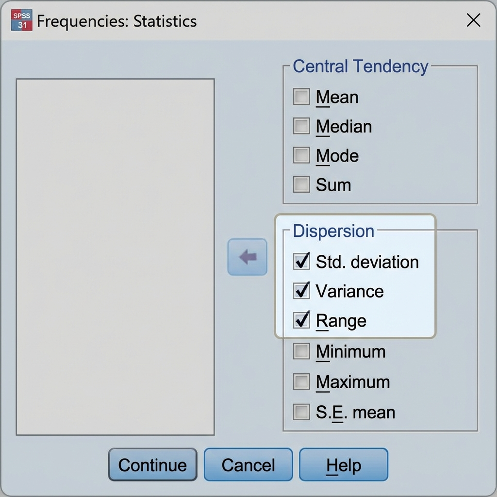
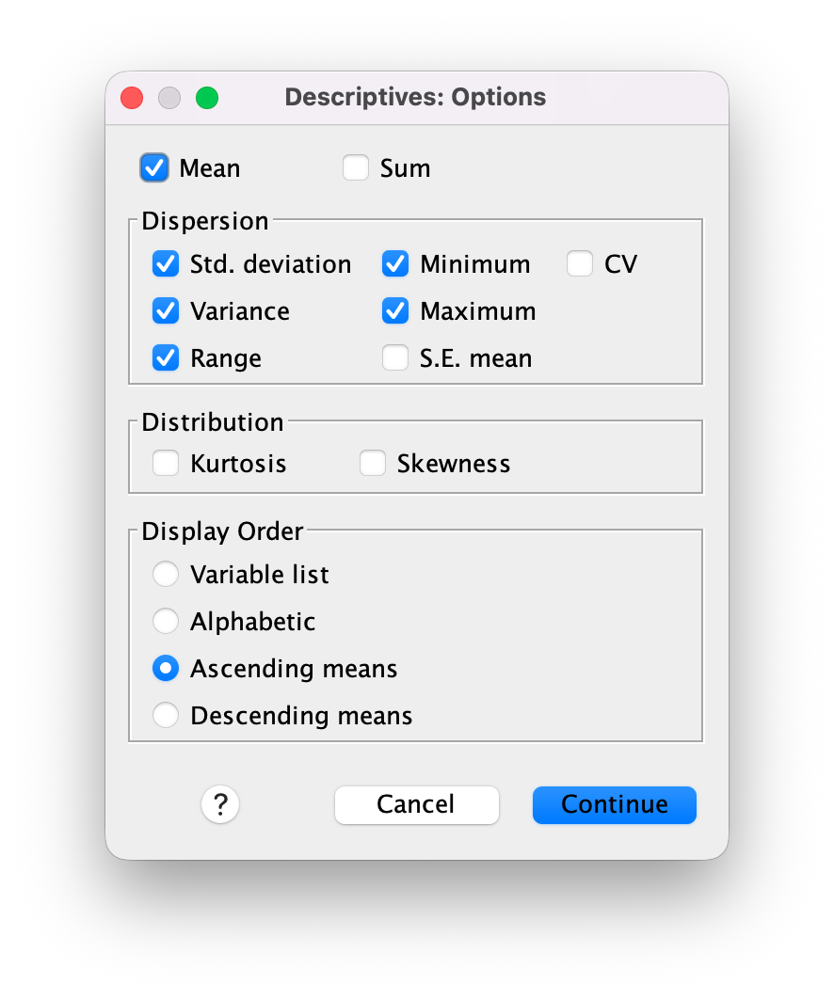
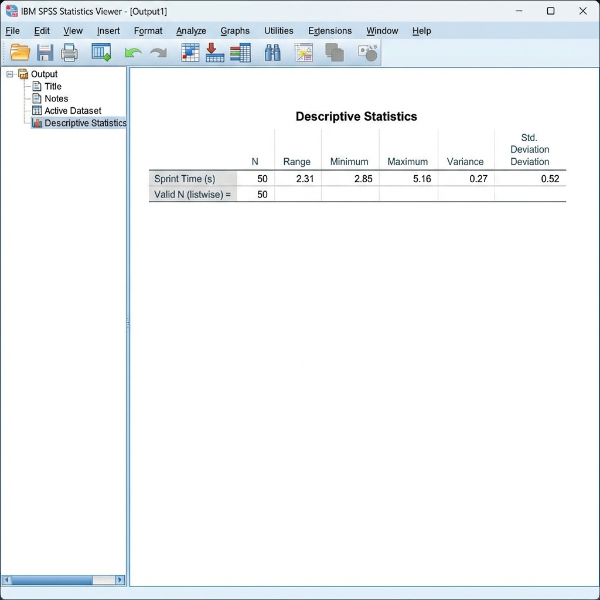
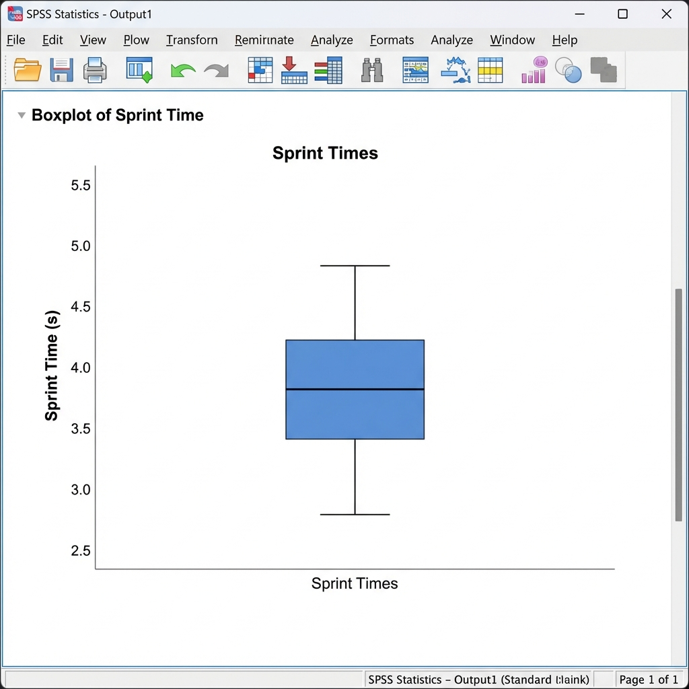

## Purpose & Outcomes

This tutorial teaches you how to calculate and interpret measures of variability using SPSS 31. By the end, you will be able to compute the range, variance, and standard deviation for continuous variables using the Frequencies, Descriptives, and Explore procedures. You will learn when to use each procedure, how to interpret the output tables, and how to report these statistics in APA format. Additionally, you will understand how variability measures complement measures of central tendency and what they reveal about the spread or dispersion of your data.

## Why This Matters

Measures of variability describe how spread out or dispersed the values in a dataset are. While measures of central tendency (mean, median, mode) tell you where the center of your data is, measures of variability tell you how much the data points differ from that center. Understanding variability is essential for describing your data completely, assessing the reliability of measurements, comparing the consistency of different groups, and making informed decisions about statistical analyses. Two groups can have identical means but vastly different variability, leading to different interpretations and conclusions.

## Understanding Measures of Variability

Before diving into SPSS procedures, it's important to understand what each measure represents and when to use it.

### The Range
The **range** is the simplest measure of variability, calculated as the difference between the maximum and minimum values in your dataset. While easy to compute and understand, the range is highly sensitive to outliers—a single extreme value can dramatically inflate the range. The range provides a quick sense of the total spread but doesn't tell you anything about how the values are distributed within that spread.

**Formula**: Range = Maximum − Minimum

### The Variance
The **variance** measures the average squared deviation of each data point from the mean. It considers every value in the dataset, not just the extremes. Because deviations are squared, the variance is always positive and is expressed in squared units (e.g., seconds², cm²), which can make interpretation less intuitive. The variance is fundamental to many statistical procedures, including ANOVA and regression, but for descriptive purposes, the standard deviation is often preferred.

**Population Formula**: $\sigma^2 = \frac{\sum(X - \mu)^2}{N}$

**Sample Formula**: $s^2 = \frac{\sum(X - \bar{X})^2}{n-1}$

### The Standard Deviation
The **standard deviation** is the square root of the variance and is expressed in the same units as the original data, making it more interpretable. It represents the typical or average distance of data points from the mean. A small standard deviation indicates that values cluster tightly around the mean (low variability), while a large standard deviation indicates that values are more spread out (high variability). For normally distributed data, approximately 68% of values fall within one standard deviation of the mean, and about 95% fall within two standard deviations.

**Population Formula**: $\sigma = \sqrt{\frac{\sum(X - \mu)^2}{N}}$

**Sample Formula**: $s = \sqrt{\frac{\sum(X - \bar{X})^2}{n-1}}$

::: {.callout-important}
## Sample vs. Population Formulas
SPSS uses the **sample formula** (with *n*−1 in the denominator) by default for variance and standard deviation. This provides an unbiased estimate of population parameters. The *n*−1 correction is called the **degrees of freedom** adjustment. When reporting results from SPSS, you're typically reporting sample statistics unless you've specifically requested population parameters.
:::

### Coefficient of Variation
The **coefficient of variation (CV)** is a normalized measure of variability that expresses the standard deviation as a percentage of the mean. It's useful for comparing variability across variables measured in different units or with different means. A CV of 10% means the standard deviation is 10% of the mean.

**Formula**: $CV = \frac{s}{\bar{X}} \times 100$

## SPSS Procedures for Calculating Variability

SPSS offers three main procedures for calculating measures of variability: **Frequencies**, **Descriptives**, and **Explore**. Each has different strengths.

### When to Use Frequencies
Use the **Frequencies** procedure when you want:

- Range, variance, and standard deviation along with central tendency
- Frequency tables and histograms
- Percentiles and quartiles
- Analysis of both continuous and categorical variables

### When to Use Descriptives
Use the **Descriptives** procedure when you want:

- Quick, compact output for multiple continuous variables
- Range, variance, standard deviation, minimum, and maximum
- Efficient analysis without frequency tables
- Option to save standardized (z-score) values

### When to Use Explore
Use the **Explore** procedure when you want:

- Comprehensive descriptive statistics and diagnostics
- Boxplots and stem-and-leaf plots
- Tests for normality (Shapiro-Wilk, Kolmogorov-Smirnov)
- Outlier detection and identification
- Separate analyses by groups

## Method 1: Using Frequencies

The Frequencies procedure provides variability measures alongside central tendency and frequency distributions.

### Step-by-Step Instructions

**Step 1: Open Your Dataset**

Ensure your data file is open in SPSS. For this tutorial, we'll use the `core_session.csv` file filtered to pre-intervention data only.

**Step 2: Access the Frequencies Dialog**

Navigate to the menu bar and select:

**Analyze > Descriptive Statistics > Frequencies**

**Step 3: Select Your Variable(s)**

1. Move the variable(s) you want to analyze to the **Variable(s):** box
2. For continuous variables with many unique values, consider suppressing the frequency table by clicking **Format** and selecting "Suppress tables with more than N categories"

**Step 4: Request Statistics**

Click the **Statistics** button to open the Frequencies: Statistics subdialog.

{#fig-frequencies-dispersion fig-alt="Frequencies Statistics dialog showing Dispersion section" style="text-align: center" width="60%"}

In the **Dispersion** section, check the boxes for:

- ☑ **Std. deviation** — Standard deviation
- ☑ **Variance** — Variance
- ☑ **Range** — Range (max − min)
- ☑ **Minimum** — Smallest value
- ☑ **Maximum** — Largest value

You can also select:

- **S.E. mean** — Standard error of the mean (SD/√n)

Click **Continue** to return to the main dialog, then click **OK** to run the analysis.

### Interpreting Frequencies Output

The output will contain a Statistics table showing your requested measures of variability.

**Reading the Output Table:**

- **N Valid**: Number of cases with non-missing values
- **N Missing**: Number of cases with missing values
- **Std. Deviation**: Typical distance from the mean
- **Variance**: Average squared deviation from the mean
- **Range**: Difference between max and min
- **Minimum**: Smallest value in the dataset
- **Maximum**: Largest value in the dataset

**Interpretation Example:**

For sprint time with SD = 0.35 s, Variance = 0.126 s², Range = 1.55 s:

- Sprint times typically deviate about 0.35 seconds from the mean
- The variance is 0.126 squared seconds (less interpretable than the SD)
- The fastest and slowest times differ by 1.55 seconds
- This relatively small variability suggests good consistency in sprint performance across participants

### Syntax for Frequencies

```{.default}
* Calculate measures of variability using Frequencies.
FREQUENCIES VARIABLES=sprint_20m_s
  /STATISTICS=STDDEV VARIANCE RANGE MINIMUM MAXIMUM
  /FORMAT=NOTABLE
  /ORDER=ANALYSIS.
```

## Method 2: Using Descriptives

The Descriptives procedure provides a compact, efficient way to calculate variability measures for multiple continuous variables.

### Step-by-Step Instructions

::: callout-tip
## One-file Steps
You can view all the steps for this method in a single summary. Click [here](assets/images/ch05/steps/var-method2.pdf){.lightbox} to open the file or click [here](assets/images/ch05/steps/var-method2.pdf){.download} to download it. 
:::

**Step 1: Access the Descriptives Dialog**

Navigate to the menu bar and select:

**Analyze > Descriptive Statistics > Descriptives**

**Step 2: Select Your Variable(s)**

1. From the variable list on the left, select the variable(s) you want to analyze
2. Click the arrow button to move them to the **Variable(s):** box
3. You can analyze multiple variables simultaneously

**Step 3: Configure Options**

Click the **Options** button to specify which statistics to calculate.

{#fig-descriptives-dispersion fig-alt="Descriptives Options dialog showing dispersion statistics" style="text-align: center" width="60%"}

In the Options dialog, check:

- ☑ **Mean** — Arithmetic average (for context)
- ☑ **Std. deviation** — Standard deviation
- ☑ **Variance** — Variance
- ☑ **Range** — Range
- ☑ **Minimum** — Smallest value
- ☑ **Maximum** — Largest value

Click **Continue** to return to the main dialog, then click **OK** to run the analysis.

### Interpreting Descriptives Output

The output displays a compact table with summary statistics for each variable.

{#fig-variability-output fig-alt="Descriptives output table showing variability measures" width="80%" style="display: block; margin: 0 auto;"}

**Reading the Output Table:**

- **N**: Number of valid cases
- **Range**: Difference between maximum and minimum
- **Minimum**: Lowest value in the dataset
- **Maximum**: Highest value in the dataset
- **Variance**: Average squared deviation from the mean
- **Std. Deviation**: Square root of variance, in original units

**Interpretation Example:**

For sprint time with N = 60, Range = 1.55, Min = 2.90, Max = 4.45, Variance = 0.13, SD = 0.35:

- 60 participants completed the sprint at baseline
- Times ranged from 2.90 to 4.45 seconds (a 1.55-second range)
- The variance is 0.13 s²
- The standard deviation is 0.35 s, meaning most participants’ times fall within about ±0.35 s of the mean

### Syntax for Descriptives

```{.default}
* Calculate variability measures using Descriptives.
DESCRIPTIVES VARIABLES=sprint_20m_s
  /STATISTICS=MEAN STDDEV VARIANCE RANGE MIN MAX.
```

## Method 3: Using Explore

The Explore procedure provides the most comprehensive analysis, including variability measures, visual diagnostics, and outlier detection.

### Step-by-Step Instructions

**Step 1: Access the Explore Dialog**

Navigate to the menu bar and select:

**Analyze > Descriptive Statistics > Explore**

{#fig-explore-menu fig-alt="SPSS menu showing path to Explore" style="text-align: center"}

This opens the Explore dialog box.

{#fig-explore-dialog fig-alt="SPSS Explore main dialog box" style="text-align: center"}

**Step 2: Select Your Variable(s)**

1. Move the variable(s) you want to analyze to the **Dependent List:** box
2. Optionally, move a grouping variable to the **Factor List:** box to compare variability across groups
3. In the **Display** section, select **Both** (for statistics and plots) or choose **Statistics** or **Plots** individually

**Step 3: Configure Statistics and Plots**

Click the **Statistics** button to select which statistics to display. The default includes descriptive statistics, outliers, and percentiles.

Click the **Plots** button to select visualizations. By default, Explore produces:

- Boxplots (showing median, quartiles, range, and outliers)
- Stem-and-leaf plots
- Normality plots

**Step 4: Run the Analysis**

Click **OK** to execute the analysis. SPSS will generate comprehensive output including tables and graphs.

### Interpreting Explore Output

The Explore procedure produces extensive output:

**Descriptives Table:**

- Mean, median, and other central tendency measures
- Standard deviation, variance, range
- Interquartile range (IQR = 75th percentile − 25th percentile)
- Minimum and maximum values
- Skewness and kurtosis (distribution shape)

**Boxplot:**

{#fig-boxplot-output fig-alt="Boxplot showing sprint time distribution" style="text-align: center"}

The boxplot visually displays variability:

- The **box** represents the interquartile range (IQR), containing the middle 50% of data
- The **line inside the box** is the median
- The **whiskers** extend to the minimum and maximum values (or to 1.5 × IQR)
- **Outliers** are shown as individual points beyond the whiskers

**Interpretation:**

A wide box indicates high variability in the middle 50% of data. Long whiskers indicate extreme values. Outliers appear as circles or asterisks and warrant investigation.

### Syntax for Explore

```{.default}
* Comprehensive exploration with variability measures.
EXAMINE VARIABLES=sprint_20m_s
  /PLOT BOXPLOT STEMLEAF NPPLOT
  /STATISTICS DESCRIPTIVES
  /CINTERVAL 95
  /MISSING LISTWISE
  /NOTOTAL.
```

## Comparing the Three Procedures

| Feature | Frequencies | Descriptives | Explore |
|---------|-------------|--------------|---------|
| **Standard Deviation** | ✓ Yes | ✓ Yes | ✓ Yes |
| **Variance** | ✓ Yes | ✓ Yes | ✓ Yes |
| **Range** | ✓ Yes | ✓ Yes | ✓ Yes |
| **IQR** | Via percentiles | ✗ No | ✓ Yes |
| **Boxplots** | ✗ No | ✗ No | ✓ Yes |
| **Outlier Detection** | ✗ No | ✗ No | ✓ Yes |
| **Normality Tests** | ✗ No | ✗ No | ✓ Yes |
| **Compact Output** | ✗ No | ✓ Yes | ✗ No |
| **Best For** | General analysis | Quick summaries | Comprehensive diagnostics |

## Understanding Variability in Context

### Interpreting Standard Deviation

The standard deviation is most meaningful when considered relative to the mean and the context of your measurement:

**Small SD relative to mean:**

- Data points cluster tightly around the mean
- High consistency or homogeneity
- Example: Sprint times with *M* = 3.79 s, *SD* = 0.35 s (CV = 9.3%)

**Large SD relative to mean:**

- Data points are widely dispersed
- High variability or heterogeneity
- Example: Body mass with *M* = 73.83 kg, *SD* = 15.22 kg (CV = 20.6%)

### The 68-95-99.7 Rule

For approximately normal distributions:

- About **68%** of values fall within ±1 SD of the mean
- About **95%** of values fall within ±2 SD of the mean
- About **99.7%** of values fall within ±3 SD of the mean

This rule helps you understand what "typical" variability looks like and identify potential outliers.

### Comparing Variability Across Groups

When comparing two or more groups, examine both central tendency and variability:

- **Same mean, different SD**: Groups have the same average but different consistency
- **Different mean, same SD**: Groups differ in average but have similar variability
- **Different mean, different SD**: Groups differ in both location and spread

::: {.callout-tip}
## Practical Example
Two training groups might have the same mean improvement (5 seconds), but Group A has SD = 1.0 s (very consistent) while Group B has SD = 4.0 s (highly variable). This suggests Group A's training produces more predictable results.
:::

## Reporting Results in APA Format

When reporting measures of variability in research papers or assignments, follow APA style guidelines:

### Reporting Standard Deviation with the Mean
"The mean 20-m sprint time was 3.79 s (*SD* = 0.35, *N* = 60)."

or in a sentence:

"Participants completed the 20-m sprint in an average of 3.79 seconds (*SD* = 0.35), with times ranging from 2.90 to 4.45 seconds."

### Reporting Range
"Sprint times ranged from 2.90 to 4.45 seconds (range = 1.55 s)."

### Reporting Variance
Variance is rarely reported alone in APA format. When needed:

"The variance in sprint times was 0.13 s²."

### Reporting Coefficient of Variation
"The coefficient of variation for sprint time was 9.3%, indicating low-to-moderate variability relative to the mean."

### In a Table

| Variable | *N* | *M* | *SD* | Variance | Range | Min | Max |
|----------|-----|-----|------|----------|-------|-----|-----|
| Sprint Time (s) | 60 | 3.79 | 0.35 | 0.13 | 1.55 | 2.90 | 4.45 |
| VO₂max (mL·kg⁻¹·min⁻¹) | 60 | 41.34 | 6.82 | 46.48 | 29.60 | 26.90 | 56.50 |

*Note.* *M* = mean; *SD* = standard deviation; Min = minimum; Max = maximum. Pre-training time point (*N* = 60).

### Reporting with Graphical Display

When presenting means and standard deviations graphically, use error bars to show ±1 SD:

"Figure 1 displays mean sprint times (±1 *SD*) for the training and control groups at baseline."

::: {.callout-warning}
## Avoid Dynamite Plots
Recent recommendations suggest avoiding "dynamite plunger plots" (bar charts with error bars) because they hide the distribution of individual data points. Instead, use dot plots or violin plots that show both summary statistics and the underlying data distribution.
:::

## Sample Dataset for This Tutorial

We will use the **Core Dataset** from this book, specifically the `core_session.csv` file. This dataset comes from a mixed neuromuscular training study with recreationally active adults.

::: {.callout-tip}
## Download the dataset
Click to download: [core_session.csv](data/core_session.csv)

For complete information about this dataset, see the **Core Dataset Overview** and **Core Dataset Codebook** chapters.
:::

### Variables We'll Analyze

For this tutorial, we'll focus on these continuous variables:

- **sprint_20m_s**: 20-meter sprint time in seconds (lower is better)
- **vo2_mlkgmin**: Aerobic capacity estimate in mL·kg⁻¹·min⁻¹ (higher is better)
- **mass_kg**: Body mass in kilograms

We'll primarily use **sprint_20m_s** at the **pre** time point to demonstrate calculating measures of variability.

## Practical Example: Complete Workflow

Let's walk through a complete example using the 20-meter sprint times from the Core Dataset.

### Scenario
You have collected 20-meter sprint times from participants at baseline and want to describe the variability in sprint performance to understand how consistent or variable the group is.

### Step 1: Import and Prepare the Data

1. Download `core_session.csv` from the link above
2. Open SPSS and import the file using **File > Open > Data**
3. Save it as `core_session.sav` in your data folder

::: {.callout-important}
## Filter for Pre-Intervention Data Only
Since the dataset contains three time points (pre, mid, post), we need to filter to analyze only the baseline (pre) measurements.

**Using Menus:**

1. Go to **Data > Select Cases**
2. Choose "If condition is satisfied" and click **If**
3. Enter: `time = "pre"`
4. Click **Continue**, then **OK**

**Using Syntax:**

```{.default}
* Select only pre-intervention cases.
SELECT IF (time = "pre").
EXECUTE.
```
:::

### Step 2: Calculate Variability Using Descriptives

Since we want a quick summary of variability measures:

1. Go to **Analyze > Descriptive Statistics > Descriptives**
2. Move `sprint_20m_s` to the Variable(s) box
3. Click **Options**
4. Check: Mean, Std. deviation, Variance, Range, Minimum, Maximum
5. Click **Continue**, then **OK**

**Syntax:**

```{.default}
* Calculate variability measures for sprint time.
DESCRIPTIVES VARIABLES=sprint_20m_s
  /STATISTICS=MEAN STDDEV VARIANCE RANGE MIN MAX.
```

### Step 3: Interpret the Output

Examine the Descriptive Statistics table. For `sprint_20m_s` at pre-training (*N* = 60):

```
Descriptive Statistics
                N    Range   Minimum  Maximum   Mean    Std. Deviation  Variance
sprint_20m_s   60   1.55    2.90     4.45      3.79    .354            .126
Valid N (listwise)  60
```

- **N** = 60: All 60 pre-training participants
- **Range** = 1.55 s: Difference between fastest and slowest
- **Minimum** = 2.90 s: Fastest sprint time
- **Maximum** = 4.45 s: Slowest sprint time
- **Mean** = 3.79 s: Average sprint time
- **Variance** = 0.126 s²: Average squared deviation
- **Std. Deviation** = 0.354 s: Typical deviation from the mean

### Step 4: Calculate Coefficient of Variation

The coefficient of variation isn't automatically calculated, but you can compute it:

CV = (SD / Mean) × 100 = (0.354 / 3.79) × 100 = **9.3%**

This indicates that the standard deviation is about 9.3% of the mean, representing low-to-moderate variability.

### Step 5: Create a Boxplot for Visual Assessment

To visualize the variability and identify potential outliers:

1. Go to **Analyze > Descriptive Statistics > Explore**
2. Move `sprint_20m_s` to the Dependent List
3. Select **Both** under Display
4. Click **OK**

**Syntax:**

```{.default}
* Create boxplot and comprehensive statistics.
EXAMINE VARIABLES=sprint_20m_s
  /PLOT BOXPLOT
  /STATISTICS DESCRIPTIVES
  /MISSING LISTWISE.
```

The boxplot will show:

- The median (line inside the box)
- The IQR (height of the box)
- The range (whiskers)
- Any outliers (individual points)

### Step 6: Assess Variability in Context

With SD = 0.354 s and Mean = 3.79 s:

- Most participants' sprint times fall between 3.44 s and 4.15 s (Mean ± 1 SD)
- The CV of 9.3% indicates low-to-moderate variability
- The range of 1.55 s shows the total spread from fastest to slowest
- The IQR of 0.48 s (Q1 = 3.54 s, Q3 = 4.03 s) confirms the middle 50% of participants are tightly clustered
- This relatively low variability is consistent with a fairly homogeneous sample of recreationally active adults

### Step 7: Report the Results

"Twenty-meter sprint times at baseline (*N* = 60) ranged from 2.90 to 4.45 seconds (*M* = 3.79 s, *SD* = 0.35 s). The coefficient of variation was 9.3%, indicating low-to-moderate variability in sprint performance. Visual inspection of the boxplot revealed no extreme outliers, and the distribution appeared approximately symmetric."

## Common Pitfalls and Troubleshooting

### Pitfall 1: Confusing Variance and Standard Deviation
**Problem**: Reporting variance when standard deviation is more appropriate, or vice versa.

**Solution**: For descriptive purposes, report the standard deviation because it's in the same units as your data. Variance is more commonly used in inferential statistics (ANOVA, regression).

### Pitfall 2: Ignoring the Scale of Measurement
**Problem**: Comparing standard deviations across variables with different units or scales.

**Solution**: Use the coefficient of variation to compare variability across different measures. CV normalizes the SD by the mean, allowing meaningful comparisons.

### Pitfall 3: Overlooking Outliers
**Problem**: Reporting variability measures without checking for outliers that may inflate the SD and range.

**Solution**: Always create a boxplot or use the Explore procedure to identify outliers. Investigate whether outliers are data entry errors or legitimate extreme values.

### Pitfall 4: Misinterpreting Small vs. Large SD
**Problem**: Not considering the SD relative to the mean or the context of measurement.

**Solution**: Calculate the coefficient of variation. An SD of 5 might be large for a variable with a mean of 10 (CV = 50%) but small for a variable with a mean of 100 (CV = 5%).

### Pitfall 5: Forgetting Degrees of Freedom
**Problem**: Manually calculating variance or SD using *n* instead of *n*−1.

**Solution**: SPSS automatically uses the sample formula (*n*−1) for unbiased estimates. If you're calculating by hand, remember to use *n*−1 for sample statistics.

### Pitfall 6: Reporting Only Central Tendency
**Problem**: Describing data with only the mean, without reporting variability.

**Solution**: Always report both central tendency and variability. Two groups can have identical means but vastly different SDs, leading to different interpretations.

## Practice Exercise

Use the Core Dataset to practice calculating measures of variability for a different variable.

### Practice Data

Use the same `core_session.csv` file you downloaded earlier. For this exercise, you'll analyze **aerobic capacity** (VO₂) at baseline.

### Tasks

1. **Filter the data** to include only pre-intervention measurements (`time = "pre"`)
2. **Calculate variability measures** using the Descriptives procedure for the `vo2_mlkgmin` variable
3. **Calculate the coefficient of variation** manually from the output
4. **Create a boxplot** using the Explore procedure to visualize variability and identify outliers
5. **Compare variability** between sprint time and VO₂ using the coefficient of variation
6. **Write a brief results paragraph** in APA format reporting your findings

::: {#practice-solutions style="display:none;"}
<h2 style="margin-top: 1em; font-size: 1.5em; font-weight: bold;">Practice Solutions</h2>

**Task 1: Filter for Pre-Intervention**

**Using Menus:**

1. Go to **Data > Select Cases**
2. Choose "If condition is satisfied" and click **If**
3. Enter: `time = "pre"`
4. Click **Continue**, then **OK**

**Syntax:**

```{.default}
* Select only baseline measurements.
SELECT IF (time = "pre").
EXECUTE.
```

**Task 2: Calculate Variability Measures**

1. Go to **Analyze > Descriptive Statistics > Descriptives**
2. Move `vo2_mlkgmin` to the Variable(s) box
3. Click **Options**
4. Check: Mean, Std. deviation, Variance, Range, Minimum, Maximum
5. Click **Continue**, then **OK**

**Syntax:**

```{.default}
DESCRIPTIVES VARIABLES=vo2_mlkgmin
  /STATISTICS=MEAN STDDEV VARIANCE RANGE MIN MAX.
```

**Task 3: Calculate Coefficient of Variation**

Based on the actual Core Dataset (pre-training, *N* = 60):
- Mean = 41.34 mL·kg⁻¹·min⁻¹
- SD = 6.82 mL·kg⁻¹·min⁻¹

CV = (SD / Mean) × 100 = (6.82 / 41.34) × 100 = **16.5%**

**Task 4: Create Boxplot**

1. Go to **Analyze > Descriptive Statistics > Explore**
2. Move `vo2_mlkgmin` to the Dependent List
3. Select **Both** under Display
4. Click **OK**

**Syntax:**

```{.default}
EXAMINE VARIABLES=vo2_mlkgmin
  /PLOT BOXPLOT
  /STATISTICS DESCRIPTIVES
  /MISSING LISTWISE.
```

**Task 5: Compare Variability**

- Sprint time: CV = 9.3% (low-to-moderate variability)
- VO₂max: CV = 16.5% (moderate variability)

VO₂max shows notably more relative variability than sprint time, suggesting greater heterogeneity in aerobic fitness compared to sprint performance within this sample.

**Task 6: APA Results Paragraph**

"Aerobic capacity at baseline (*N* = 60) ranged from 26.9 to 56.5 mL·kg⁻¹·min⁻¹ (*M* = 41.34 mL·kg⁻¹·min⁻¹, *SD* = 6.82 mL·kg⁻¹·min⁻¹, variance = 46.48). The coefficient of variation was 16.5%, indicating moderate variability in aerobic fitness. Visual inspection of the boxplot revealed no extreme outliers, and the interquartile range (IQR = 9.80 mL·kg⁻¹·min⁻¹) suggested reasonable consistency in the middle 50% of the distribution."

::: {.callout-tip}
## Extension Activity
Try comparing variability in VO₂ between the training and control groups at baseline. Use **Data > Split File** by group, then run the Descriptives procedure. Do the two groups have similar variability, or is one group more heterogeneous than the other?
:::

:::

```{=html}
<script>
document.addEventListener('keydown', function(e) {
  // Check for Ctrl+` (backtick)
  if (e.ctrlKey && e.key === '`') {
    e.preventDefault();
    const solutions = document.getElementById('practice-solutions');
    if (solutions) {
      solutions.style.display = solutions.style.display === 'none' ? 'block' : 'none';
    }
  }
});
</script>
```

## Quick Reference: Syntax Templates

### Frequencies (Variability Measures)
```{.default}
FREQUENCIES VARIABLES=variable_name
  /STATISTICS=STDDEV VARIANCE RANGE MINIMUM MAXIMUM
  /FORMAT=NOTABLE
  /ORDER=ANALYSIS.
```

### Descriptives (Variability Measures)
```{.default}
DESCRIPTIVES VARIABLES=variable_name
  /STATISTICS=MEAN STDDEV VARIANCE RANGE MIN MAX.
```

### Explore (Comprehensive Analysis)
```{.default}
EXAMINE VARIABLES=variable_name
  /PLOT BOXPLOT STEMLEAF
  /STATISTICS DESCRIPTIVES
  /CINTERVAL 95
  /MISSING LISTWISE.
```

### Multiple Variables
```{.default}
DESCRIPTIVES VARIABLES=var1 var2 var3
  /STATISTICS=MEAN STDDEV VARIANCE RANGE MIN MAX.
```

### By Group (Split File)
```{.default}
SORT CASES BY group.
SPLIT FILE LAYERED BY group.
DESCRIPTIVES VARIABLES=variable_name
  /STATISTICS=MEAN STDDEV VARIANCE RANGE MIN MAX.
SPLIT FILE OFF.
```

## Readiness Checklist

Before moving on, ensure you can:

- [ ] Explain the difference between range, variance, and standard deviation
- [ ] Understand why SD is more interpretable than variance
- [ ] Calculate and interpret the coefficient of variation
- [ ] Navigate to and use the Frequencies procedure for variability
- [ ] Navigate to and use the Descriptives procedure for variability
- [ ] Navigate to and use the Explore procedure for comprehensive analysis
- [ ] Interpret boxplots and identify outliers
- [ ] Apply the 68-95-99.7 rule for normal distributions
- [ ] Report measures of variability in APA format
- [ ] Write and run syntax for calculating variability
- [ ] Compare variability across different variables or groups
- [ ] Recognize when variability is high or low relative to the mean

## Additional Resources

- **SPSS Help**: Press F1 within SPSS for context-sensitive help
- **IBM SPSS Documentation**: Comprehensive guides available through IBM's website
- **APA Publication Manual** (7th ed.): For detailed reporting guidelines
- **Course Textbook**: Review the chapter on variability for conceptual understanding

::: {.callout-note}
## Next Steps
Once you're comfortable calculating measures of variability, the next tutorial will cover **the normal distribution and standard scores (z-scores)**, which build on your understanding of the mean and standard deviation to describe relative positions within a distribution.
:::
