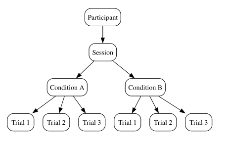
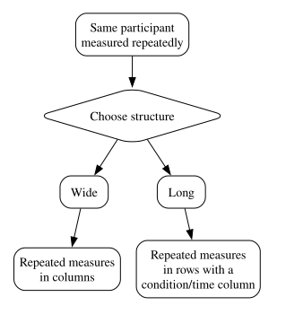

## Chapter roadmap

Before you can compute a mean, run a t test, or build a regression model, you need data that *mean what you think they mean*. In Movement Science, data are often messy because we measure people across trials, sessions, limbs, and conditions, sometimes with multiple devices and multiple testers. Chapter 2 focuses on how to classify variables, choose sensible structures, and organize observations so later analyses are valid and interpretable.

By the end of this chapter, you will be able to:

- Classify variables by type and measurement scale using Movement Science examples.
- Explain the difference between the unit of measurement and the unit of analysis.
- Organize data into analysis-ready tables and summaries.
- Screen data for common problems before running statistical tests.
- Make defensible decisions about trials, aggregation, and repeated observations.

::: callout-note
## The mindset for Chapter 2

Statistical methods assume your dataset is a faithful record of what happened. If your data structure is wrong, you can compute impressive statistics that answer the wrong question. This chapter helps you avoid that outcome.
:::

## What a dataset represents in Movement Science

A dataset is a structured record of observations. Each observation is created by a process: who was measured, under what conditions, using what protocol, and when. In Movement Science research, observations are rarely "one and done." A single participant might produce multiple trials, multiple sessions, and multiple outcome measures. This is powerful because repeated observations increase information. It is also risky because repeated observations can be mistakenly treated as independent when they are not.

### Unit of measurement vs unit of analysis

Two phrases that sound similar but often create confusion are the **unit of measurement** and the **unit of analysis**.

- The **unit of measurement** is what you directly measured. For example, a *single CMJ trial*.
- The **unit of analysis** is what your statistical method treats as the main observational unit. For example, the *participant*.

You can measure at one level and analyze at another, but you must be explicit.

::: callout-important
## Why this matters

If you treat 3 trials from each participant as 3 independent cases, you inflate your sample size and can make results look more certain than they truly are. This issue is often called **pseudo-replication**.
:::

### A common Movement Science scenario

Suppose you measure 20 participants, each performing 5 trials in two conditions. You now have 20 × 5 × 2 = 200 trial rows available. That does not automatically mean you have 200 independent observations. In many designs, your true independent units are still the 20 participants because trials are nested within participants.

{#fig-nesting width="50%"}

```{dot}
//| eval: false
//| echo: false
//| out-width: "50%"
digraph G {
  rankdir=TD;
  margin=0.2;
  pad=0.2;
  node [shape=box, style="rounded,filled", fillcolor=white, margin=0.1];

  P [label="Participant"];
  S [label="Session"];
  CA [label="Condition A"];
  CB [label="Condition B"];
  T1A [label="Trial 1"];
  T2A [label="Trial 2"];
  T3A [label="Trial 3"];
  T1B [label="Trial 1"];
  T2B [label="Trial 2"];
  T3B [label="Trial 3"];

  P -> S;
  S -> CA;
  S -> CB;
  CA -> T1A;
  CA -> T2A;
  CA -> T3A;
  CB -> T1B;
  CB -> T2B;
  CB -> T3B;
}
```

## Types of variables in Movement Science research

A **variable** is any characteristic that can vary across people, time, conditions, or trials. Some variables represent outcomes (what you care about), while others represent predictors, grouping factors, or design information (time, condition, session).

### The practical variable types

The categories below are more useful than memorizing definitions because they map directly to how you summarize and model data.

**Continuous variables** can take on many possible values along a continuum. Many Movement Science outcomes are continuous.

Examples: jump height (cm), peak force (N), reaction time (ms), joint angle (degrees), VO₂ (mL·kg⁻¹·min⁻¹).

**Discrete variables** take on separated values, often counts.

Examples: number of errors, number of falls, number of repetitions completed, number of injuries.

**Binary variables** have two categories.

Examples: injury yes or no, success or failure, left vs right limb (if coded as two levels).

**Categorical variables** have multiple categories, often representing groups or conditions.

Examples: intervention group (strength, plyometric, control), sport (soccer, basketball, track), task condition (eyes open, eyes closed).

### Special variables you will see often

**Counts, rates, and proportions.** Counts are totals, rates incorporate a denominator (exposures, time), and proportions are bounded between 0 and 1 (or 0% to 100%). These behave differently than typical continuous variables.

* Count: number of injuries in a season
* Rate: injuries per 1000 athlete-exposures
* Proportion: successful free throws out of attempts, balance task success rate

**Composite scores and indices.** Many clinical and performance measures are composites (sums or weighted combinations). Composites can be useful, but you must know what the score represents and whether it is treated as ordinal or approximately continuous.

::: callout-note

## Real example box: "time" is not always simple

Time is often treated as continuous, but the meaning depends on context. Reaction time is typically continuous. Time-to-event (like return-to-play time) is also time, but it has different statistical behavior because many participants may not experience the event during the study window.
:::

## Scales of measurement and interpretation

Measurement scales describe what the values *mean* and what operations are logically valid. The scale does not merely describe the data, it constrains how you can summarize and compare.

| Scale    | What values represent          | Movement Science example                   | What is meaningful                      |
| -------- | ------------------------------ | ------------------------------------------ | --------------------------------------- |
| Nominal  | categories, no order           | sport, injury type, group                  | equal vs not equal; counts, proportions |
| Ordinal  | ordered categories             | Likert items, pain categories, rank        | order; medians; comparisons by ranks    |
| Interval | equal intervals, no true zero  | temperature (°C), some standardized scores | differences; means and SD are common    |
| Ratio    | equal intervals plus true zero | force, time, distance, mass, VO₂           | differences and ratios; most statistics |

### The ordinal dilemma in applied work

In Movement Science, ordinal variables are common: pain scales, ratings of perceived exertion, readiness ratings, and many survey items. In applied research, ordinal scores are sometimes summarized with means, especially when they have many response options and behave approximately like a continuous variable.

A practical guideline is to ask: does the scale behave like equal steps? If the difference between 2 and 3 is not comparable to the difference between 7 and 8, treating the variable as continuous can be misleading. Later chapters will revisit this idea when discussing nonparametric methods and model choices.

## The structure of data: rows, columns, and identifiers

A dataset is easiest to analyze when:

* each row is one observation,
* each column is one variable,
* each cell contains a single value.

This is sometimes called *tidy data*.

### Identifiers are not optional

Movement Science datasets usually require identifiers so you can track nesting and repeated measures:

* participant ID
* session ID
* condition
* trial number
* limb side (if relevant)

Without identifiers, you can still compute numbers, but you cannot defend your analysis.

::: callout-important

## Minimum viable dataset

For repeated-measures or trial-based data, you should almost always be able to answer: *Which participant? Which session? Which condition? Which trial?*
:::

### Wide vs long: the conceptual difference

**Wide format** stores repeated measures as separate columns. This can be convenient for certain comparisons, but it becomes unwieldy when you have many time points or conditions.

**Long format** stores repeated measures as separate rows, with a column that indicates the condition or time point. Long format is often more flexible and makes grouped summaries easier.

{#fig-wide-long width="40%"}

```{dot}
//| eval: false
//| echo: false
//| out-width: "50%"
digraph G {
  rankdir=TD;
  margin=0.2;
  pad=0.2;
  node [shape=box, style="rounded,filled", fillcolor=white, margin=0.1];

  A [label="Same participant\nmeasured repeatedly"];
  B [label="Choose structure", shape=diamond];
  C [label="Wide"];
  D [label="Long"];
  E [label="Repeated measures\nin columns"];
  F [label="Repeated measures\nin rows with a\ncondition/time column"];

  A -> B;
  B -> C;
  B -> D;
  C -> E;
  D -> F;
}
```

### Example: wide vs long (mini illustration)

**Wide (one row per participant):**

| id | pre_cmj | post_cmj |
| -- | ------: | -------: |
| 01 |    32.4 |     35.1 |
| 02 |    28.9 |     29.8 |

**Long (multiple rows per participant):**

| id | time |  cmj |
| -- | ---- | ---: |
| 01 | pre  | 32.4 |
| 01 | post | 35.1 |
| 02 | pre  | 28.9 |
| 02 | post | 29.8 |


## Data coding principles: names, units, and missing data

Good coding practices are boring in the moment and lifesaving later. They reduce confusion, prevent silent errors, and make your analysis reproducible.

### Variable naming and units

A variable name should be short and stable. A label or description can be more human-friendly. Units should be recorded somewhere consistently, either in a codebook or in variable labels.

Common unit mistakes in Movement Science include mixing cm and m, ms and s, N and kgf, or degrees and radians. These mistakes are avoidable if units are explicit from the beginning.

::: callout-tip

## A simple naming convention

Use lowercase with underscores, avoid spaces, and keep units out of the name if you maintain a codebook.
Example: `cmj_height` with units recorded as cm in the codebook.
:::

### Missing data is information

Missingness is not just an inconvenience. It often has a reason: equipment failure, participant fatigue, pain, dropout, or protocol deviations. The pattern of missingness can influence your conclusions.

At this stage, your goal is not to master missing data theory. Your goal is to:

1. identify what is missing,
2. document why it is missing when possible,
3. avoid creating missingness accidentally through coding errors.


## Organizing data with tables

Tables are not only for final results. In early analysis, tables act as audits. They show whether your sample looks like what you think you collected and whether categories are coded consistently.

### Frequency tables

Frequency tables summarize categorical variables.

Example questions:

* How many participants are in each group?
* Are there unexpected categories?
* Are labels consistent?

A frequency table should be one of the first things you generate for key categorical variables.

### Two-way tables (cross-tabulations)

Cross-tabulations summarize two categorical variables at once.

Example questions:

* Is sex distribution similar across intervention groups?
* Are dropouts concentrated in one condition?

Even before inferential testing, these tables help you detect imbalance or data entry issues.

## Summarizing continuous variables responsibly

Continuous variables are often summarized with a measure of center and a measure of spread. The choice should match the distribution and the research context.

### Two common summary pairs

* **Mean and standard deviation**: useful when distributions are roughly symmetric and outliers are not extreme.
* **Median and interquartile range**: useful when distributions are skewed, bounded, or contain outliers.

In Movement Science, reaction time and time-to-completion variables can be skewed. Pain or disability scores can be bounded. Force and power measures can be influenced by rare extreme performances. Summaries should reflect these realities.

| Situation                       | Recommended summaries        | Why                                         |
| ------------------------------- | ---------------------------- | ------------------------------------------- |
| roughly symmetric distribution  | mean and SD                  | center and variability are well represented |
| skewed distribution or outliers | median and IQR               | robust to extreme values                    |
| bounded scales                  | median and IQR often helpful | avoids misleading averages near limits      |

## Data screening before analysis

Data screening is a short, structured check to make sure your dataset is plausible. It does not require advanced statistics. It requires attention.

### Range and logic checks

Ask whether values are possible.

* negative times are impossible
* joint angles outside physiological ranges are suspicious
* VO₂ values far outside realistic ranges may indicate unit problems or entry errors

### Duplicates and ID integrity

Duplicates can be true repeats (multiple trials) or accidental duplication (copy-paste errors). IDs should match the design: if you expect 20 participants and see 21 unique IDs, investigate.

### Outliers: errors vs real extremes

Outliers are not automatically bad. Elite performance can be a real outlier. But if an outlier is created by a unit conversion mistake or a decimal error, it should be corrected.

A useful habit is to classify outliers as:

* likely data error (wrong unit, typo, device glitch)
* plausible but extreme (real performance)
* unknown (requires checking notes)

### Missingness patterns

Look for whether missingness is clustered:

* do missing values occur mostly in one session?
* mostly in one group?
* mostly at post-test?

These patterns often reveal protocol or fatigue issues.

::: {#fig-screening}
::: {style="text-align: center;"}
**Data screening workflow:**

- **Range and logic checks**
- **Category and label checks**
- **Duplicates and IDs**
- **Outliers: error or extreme?**
- **Missingness patterns**
  - → Document reasons when possible
:::

Data screening workflow
:::


## Trials and aggregation decisions

Movement Science protocols frequently collect multiple trials per condition. This raises a practical question: what should become the analysis variable?

Common choices:

* mean of trials
* best trial
* median of trials
* model trial-to-trial variability explicitly

### What gets lost when you aggregate

Aggregation simplifies the dataset and can reduce random noise, but it can also hide meaningful patterns.

* In motor learning, variability across trials can be part of the phenomenon.
* In fatigue research, performance might systematically decline across trials.
* In skill assessment, best performance might reflect capacity, while average reflects typical performance.

A defensible choice depends on the question. You should write your aggregation rule before analyzing and apply it consistently.

::: callout-important

## A simple decision rule

If your question is about **capacity**, best trial may be defensible.
If your question is about **typical performance**, mean or median is usually more defensible.
If your question is about **change across attempts**, do not aggregate away the pattern.
:::

## Common data organization mistakes in Movement Science

Many problems are not mathematical. They are organizational.

### Frequent mistakes and why they matter

| Mistake                       | What it looks like                 | Why it is harmful                             |
| ----------------------------- | ---------------------------------- | --------------------------------------------- |
| Mixed units                   | some heights in cm, others in m    | creates fake differences and outliers         |
| Inconsistent labels           | control, Control, CON              | breaks grouping and tables                    |
| Missing stored as text        | "NA" or "." as values              | prevents numeric summaries                    |
| Protocol changes undocumented | different warm-ups across sessions | confounds interpretation                      |
| Losing raw trials             | only saving averages               | prevents checking reliability and variability |

::: callout-warning

## The silent failure mode

The most dangerous errors are the ones that do not trigger an obvious warning. A dataset can look clean and still encode a wrong structure or wrong units.
:::

## Mini case study: from protocol to analysis-ready dataset

::: callout-note

## Real example box: CMJ trials, pre/post, two groups

**Study idea:** Two groups complete different 6-week programs (plyometric vs control). CMJ height is measured pre and post. Each testing day includes 3 trials.

**Design questions you must answer early:**

* Is the unit of analysis the participant or the trial?
* Will you analyze the mean of 3 trials, best of 3, or keep trial-level data?
* How will you label time (pre/post) and group (plyo/control)?
* What identifiers do you need to ensure you do not mix participants or sessions?

**Analysis-ready structure:** a long format dataset with columns:
`id`, `group`, `time`, `trial`, `cmj_height`, and optional notes for anomalies.

This structure allows you to compute trial summaries, visualize distributions, and later perform inferential analyses without rebuilding the dataset.
:::

### A basic organization plan (the same plan you can reuse)

1. Define identifiers (id, session, condition/time, trial)
2. Define variable names and units
3. Enter or import raw data
4. Run screening checks (ranges, categories, missingness)
5. Create summary tables (group and time)
6. Decide on aggregation rules, then create derived summary variables

## Chapter toolkit

### Data readiness checklist (reusable)

Before any statistical test, confirm:

* I can identify every observation by participant, condition/time, and trial/session.
* Units are consistent and documented.
* Categories are coded consistently with no unexpected labels.
* Missing values are clearly represented and not stored as text in numeric columns.
* I have checked ranges, duplicates, and outliers.
* I know whether I am analyzing trials or participants, and why.

### Codebook template (reusable)

| Variable name | Description                 | Units | Type       | Allowed values / range | Missing code   |
| ------------- | --------------------------- | ----- | ---------- | ---------------------- | -------------- |
| id            | participant identifier      | none  | nominal    | unique                 | none           |
| group         | intervention group          | none  | nominal    | plyo, control          | NA             |
| time          | measurement time point      | none  | nominal    | pre, post              | NA             |
| trial         | trial number                | none  | discrete   | 1–3                    | NA             |
| cmj_height    | countermovement jump height | cm    | continuous | plausible range        | system missing |

## Chapter summary

This chapter introduced the language and structure needed to organize Movement Science data. You learned how variable types and measurement scales constrain what summaries make sense, why identifiers and the unit of analysis matter, how data structure (wide vs long) affects what you can do later, and how to screen datasets before analysis. These steps prevent common mistakes that can undermine later statistical inference.

## Key terms (study list)

* variable type
* measurement scale
* unit of measurement
* unit of analysis
* repeated measures
* identifiers
* wide format
* long format
* frequency table
* cross-tabulation
* outlier
* missing data
* aggregation

## Practice: quick checks

1. A study measures 12 participants, each performing 5 trials in two conditions. What is the unit of measurement? What is the unit of analysis if you plan to compare conditions using each participant’s mean performance?
2. Provide one example of a variable that is nominal, one that is ordinal, and one that is ratio scale in Movement Science.
3. You discover that half of the participants have jump height recorded in meters while the rest are recorded in centimeters. Describe a safe plan to detect and fix the issue.
4. Why might analyzing “best trial” lead to different conclusions than analyzing “mean of trials”?

## Read further (optional)

Look for practical resources on research data management, tidy data principles, and applied measurement practices in Movement Science. The goal is not software expertise. The goal is building datasets that support defensible scientific conclusions.

::: callout-tip

## Next chapter

Chapter 3 introduces percentiles and performance ranking tools, which are widely used in testing, screening, and clinical interpretation.
:::
