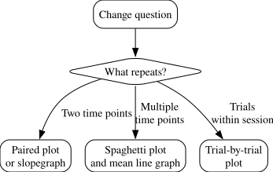
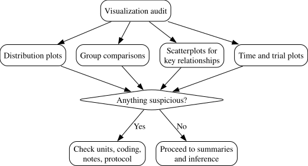
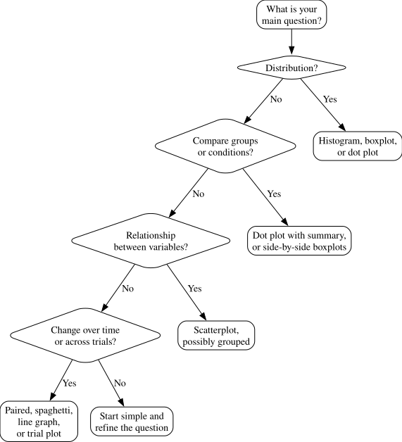

::: callout-tip
For a practical guide on how to create the graphs mentioned in this chapter, refer to @sec-appendix-spss-data-visualization in the SPSS tutorials section.
:::

## Chapter roadmap

Graphs are not decoration. In Movement Science, visualization is one of the fastest ways to understand what your data are doing, whether your measurement process behaved as expected, and whether an analysis plan makes sense. Tables can tell you an average sprint time. A good plot can reveal skew, outliers, clusters, fatigue patterns across trials, or group differences that change over time.

By the end of this chapter, you will be able to:

- Choose a graph that matches your question and variable types.
- Create and interpret a broad set of core plots used in Movement Science.
- Use visualization for data screening before inferential testing.
- Explain how graph design choices shape interpretation and can mislead.

::: callout-note
## Visualization workflow used throughout this book

Any time you are unsure what to do next, use this sequence:

1. Clarify the question (distribution, comparison, relationship, or change over time)
2. Identify variable types (categorical, quantitative, repeated measures)
3. Start simple (show raw patterns before adding summaries)
4. Check for problems (outliers, strange spikes, unit mix-ups)
5. Add context (group, condition, time) only if it helps answer the question
6. State the takeaway in one sentence, including uncertainty and limitations
:::

## Why visualization matters in Movement Science

Visualization is a form of reasoning. You are using your visual system to detect structure that is difficult to see in a spreadsheet. This matters because Movement Science datasets often contain features that can quietly break assumptions or distort conclusions.

Common patterns that are easier to see than to compute:

- Skew and heavy tails in variables like EMG amplitude and sway area
- Trial-by-trial patterns from learning or fatigue
- Group differences that change across time points
- Clusters that create misleading correlations
- Ceiling effects on bounded scales such as function scores

A good habit is to treat graphs as part of quality control. If the plot looks surprising, do not immediately blame the participants. First ask whether the data structure, coding, units, protocol, or device could explain the pattern.

::: callout-important
## A rule that prevents many mistakes

Before running inferential tests, you should have looked at the distribution of your main outcomes and the structure of change over time. Many analysis problems are visible in a plot before they show up in output tables.
:::

## Start with the question, not the graph

Students often ask, “Which graph should I use?” A better question is, “What am I trying to learn from the data?” Most visualization decisions can be reduced to four question types.

- What values occur and how often (distribution)
- Do groups or conditions differ (comparison)
- Are two variables related (relationship)
- How does something change over time or across trials (change)

### A broader menu of common graphs

This book emphasizes a core set of plots that appear repeatedly in Movement Science research. Pie charts are not included because they make comparisons difficult, especially when categories are similar in size.

| Plot type | Best for | Typical Movement Science examples |
|---|---|---|
| Bar chart | categorical distributions | group counts, injury yes/no frequencies |
| Grouped bar chart | compare categories across groups | injury status by group, sport by sex category |
| Dot plot (strip plot) | show individual values, small samples | sprint time by group, VO₂ by group |
| Histogram | distribution shape | EMG amplitude, sway area, sprint time |
| Boxplot | compare distributions | sprint time by group, sway by time point |
| Line graph | change over time (summary) | group mean sprint time across pre/mid/post |
| Paired line plot (slopegraph) | within-person change | pre vs post function score |
| Spaghetti plot | individual trajectories | individual sprint times across time |
| Scatterplot | relationships | peak force vs sprint time, VO₂ vs agility |
| Scatterplot with groups | relationships with stratification | force vs sprint by training vs control |
| Time-series style plot | sequences across trials | trial 1–3 performance, fatigue patterns |
| Error-bar plot (used carefully) | summary with uncertainty | mean with CI across groups or time |
| Heatmap (optional) | patterns across many variables | correlation matrix preview, missingness patterns |

::: callout-warning
## About summary-only plots

Bar charts of means and line graphs of means can be useful, but they can also hide variability and individual responses. When sample sizes are small or moderate, include individual points or individual trajectories whenever possible.
:::

## Match the graph to the variable type

You can choose a sensible first plot by matching the question to the variables.

| Question type | Typical variables | First-choice plots |
|---|---|---|
| Distribution | one variable | histogram, boxplot, dot plot |
| Comparison | outcome plus group or condition | dot plot with summary, side-by-side boxplots |
| Relationship | two quantitative variables | scatterplot, grouped scatterplot |
| Change | repeated measures | paired plot, spaghetti plot, line graph |
| Trial sequence | trial index plus outcome | trial-by-trial line plot, spaghetti-by-trial |

::: callout-tip
## Default choice for many graduate Movement Science datasets

When sample sizes are small or moderate, start with a dot plot for comparisons and a paired plot for change. Then add summaries, not the other way around.
:::

## Visualizing categorical variables

Categorical variables represent membership in a group or category. Examples include intervention group, sport, injury status, or condition label. The most common graphs are bar charts and grouped bar charts.

### Bar charts: counts and percentages

Counts are best for describing your sample. Percentages are best for comparing groups of different sizes. Percentages without sample sizes can be misleading, so good reporting usually includes sample size information in text or captions.

### Grouped bar charts for comparisons

If you want to compare categories across groups, grouped bars are often clearer than stacked bars because they share a common baseline.

::: callout-warning
## Common mistake: stacked bars hide comparisons

Stacked bar charts can make it hard to compare categories because most segments do not share a common baseline. Grouped bars are often clearer when your goal is comparison.
:::

## Visualizing distributions of quantitative variables

A distribution plot shows where values are located, how spread out they are, and what shape they form. In Movement Science, shape matters because many variables are not symmetric.

### Histograms

Histograms group values into bins and show frequency. They are excellent for understanding shape, but bin width can change the appearance. A useful approach is to view more than one bin width and ask whether the interpretation is stable.

::: callout-note
## What to look for in a histogram

- Symmetry versus skew
- Multiple peaks suggesting subgroups
- Extreme values that look implausible
- Spikes at round numbers suggesting rounding
:::

### Boxplots

Boxplots summarize the distribution using the median and interquartile range. They are excellent for comparisons across groups or conditions, but they can hide raw patterns in small samples. If the sample is small, overlay points or use dot plots.

### Dot plots as a default companion

Dot plots show each observation. They are especially valuable in Movement Science because sample sizes are often not huge and individual variability is scientifically meaningful.

## Comparing groups and conditions

When your question is “do groups differ,” you want to see separation between groups and variability within groups.

Good first-choice plots include:

- dot plot with a summary overlay
- side-by-side boxplots, preferably with points overlaid

Summary-only bar charts of means can hide important structure, so they should be treated as a secondary view rather than a default.

## Visualizing relationships: scatterplots

A scatterplot is the default plot for two quantitative variables. It helps you see direction, form, and strength. It also helps you see whether the relationship is nonlinear or driven by clusters.

::: callout-warning
## Common mistake: a “relationship” created by group separation

If training participants cluster in one region of a scatterplot and control participants cluster in another, the overall trend can look strong even if there is little relationship within each group. When group membership might matter, visualize with group separation or use different symbols.
:::

## Visualizing change over time and across trials

Movement Science studies often focus on change: learning, adaptation, fatigue, or recovery. These questions require plots that respect repeated measures.

### Paired plots and slopegraphs

For two time points, a paired plot shows each person’s change and makes within-person response patterns visible.

### Spaghetti plots and line graphs

For multiple time points, spaghetti plots show individual trajectories. Line graphs of group means can summarize trends, but they should not hide individual response variation when the sample is not large.

### Trial-by-trial plots

Trial-by-trial plots show within-session patterns. These plots are essential when learning or fatigue might occur. Averaging across trials without inspecting trial order can remove meaningful patterns.

{#fig-change width="50%"}

```{dot}
//| eval: false
//| echo: false
//| out-width: "50%"
digraph G {
  rankdir=TD;
  margin=0.2;
  pad=0.2;
  node [shape=box, style="rounded,filled", fillcolor=white, margin=0.1];

  A [label="Change question"];
  B [label="What repeats?", shape=diamond];
  C [label="Paired plot\nor slopegraph"];
  D [label="Spaghetti plot\nand mean line graph"];
  E [label="Trial-by-trial\nplot"];

  A -> B;
  B -> C [label="Two time points"];
  B -> D [label="Multiple\ntime points"];
  B -> E [label="Trials\nwithin session"];
}
```

## Visualization as data screening and quality control

Visualization is one of the simplest ways to detect data problems. Before inferential testing, your plots should help you answer: does this dataset look plausible?

Common visual clues include impossible values, unit mix-ups, rounding artifacts, outliers that may be errors, and missingness patterns that differ by group or time.

{#fig-viz-audit width="70%"}

```{dot}
//| eval: false
//| echo: false
//| out-width: "60%"
digraph G {
  rankdir=TD;
  margin=0.2;
  pad=0.2;
  node [shape=box, style="rounded,filled", fillcolor=white, margin=0.1];

  A [label="Visualization audit"];
  B [label="Distribution plots"];
  C [label="Group comparisons"];
  D [label="Scatterplots for\nkey relationships"];
  E [label="Time and trial plots"];
  F [label="Anything suspicious?", shape=diamond];
  G [label="Check units, coding,\nnotes, protocol"];
  H [label="Proceed to summaries\nand inference"];

  A -> B;
  A -> C;
  A -> D;
  A -> E;
  B -> F;
  C -> F;
  D -> F;
  E -> F;
  F -> G [label="Yes"];
  F -> H [label="No"];
}
```

## How graphs influence interpretation

Graphs shape what the viewer notices, what looks important, and what feels convincing. That makes visualization a scientific responsibility.

Axis scaling can exaggerate small differences, especially in bar charts. Aspect ratio can make trends look steeper or flatter. Overplotting can hide where data concentrate. Decorative elements can reduce comprehension. The ethical goal is not persuasion. The goal is clarity.

::: callout-important
## Ethical visualization principle

A scientific plot should help a reader understand the data, not persuade them to agree with you.
:::

## Choosing the right graph for the question

{#fig-choose-graph width="70%"}

```{dot}
//| eval: false
//| echo: false
//| out-width: "50%"
digraph G {
  rankdir=TD;
  margin=0.2;
  pad=0.2;
  node [shape=box, style="rounded,filled", fillcolor=white, margin=0.1];

  Q [label="What is your\nmain question?"];
  A [label="Distribution?", shape=diamond];
  B [label="Compare groups\nor conditions?", shape=diamond];
  C [label="Relationship\nbetween variables?", shape=diamond];
  E [label="Change over time\nor across trials?", shape=diamond];

  D1 [label="Histogram, boxplot,\nor dot plot"];
  D2 [label="Dot plot with summary,\nor side-by-side boxplots"];
  D3 [label="Scatterplot,\npossibly grouped"];
  D4 [label="Paired, spaghetti,\nline graph,\nor trial plot"];
  D5 [label="Start simple and\nrefine the question"];

  Q -> A;
  A -> D1 [label="Yes"];
  A -> B [label="No"];
  
  B -> D2 [label="Yes"];
  B -> C [label="No"];
  
  C -> D3 [label="Yes"];
  C -> E [label="No"];
  
  E -> D4 [label="Yes"];
  E -> D5 [label="No"];
}
```

## Worked example using the Core Dataset

::: callout-note
## Real example box: one dataset, multiple questions

The Core Dataset includes training and control groups measured at pre, mid, and post. Some outcomes are session-level (sprint time, VO₂, pain, function). Some outcomes are trial-level (jump height, peak force, EMG amplitude, sway area). The same dataset can answer multiple questions, and each question suggests a different plot.

Distribution question: What does the distribution of sway area look like at pre?

Comparison question: Do training and control differ in sprint time at pre?

Relationship question: Is peak force related to sprint time?

Change question: Do participants improve from pre to post, and do groups change differently?

Within-session question: Do trial values show a pattern from trial 1 to trial 3?
:::

The key point is that plots are aligned with questions. If you try to force one “favorite graph” onto every question, you will either hide important information or overcomplicate the presentation.

## Chapter summary

Visualization is a core tool for Movement Science statistics. Good plots reveal distribution shape, variability, outliers, group differences, relationships, and change over time. This chapter introduced a workflow for choosing graphs based on the question and variable types, and it emphasized that graph design choices can influence interpretation in ways that are scientifically meaningful.

## Key terms

distribution; histogram; bin width; boxplot; dot plot; bar chart; grouped bar chart; line graph; paired plot; slopegraph; spaghetti plot; scatterplot; outlier; overplotting; axis scaling; aspect ratio

## Practice: quick checks

1. You collect EMG amplitude data and the histogram shows a long right tail. What summaries and plots would you use to describe it responsibly?
2. A boxplot shows several outliers for peak force. List two reasons those points could be real and two reasons they could be errors.
3. A scatterplot of peak force versus sprint time shows a strong trend, but the points form two clusters. Give two plausible explanations and describe how you would visualize the data to investigate.
4. You have pre and post function scores for each participant. Which plot best shows individual change, and what question does it answer that a bar chart cannot?
5. You plot trial-by-trial jump height and see trial 1 is consistently lower than trials 2 and 3. What does that imply about using mean of trials as a summary?

::: callout-tip
## Next chapter

The next chapter introduces percentiles and standard scores, which are widely used in testing, screening, and clinical interpretation.
:::
